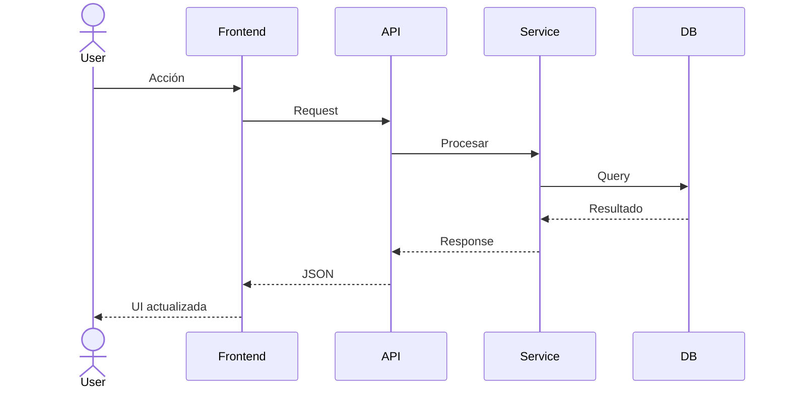
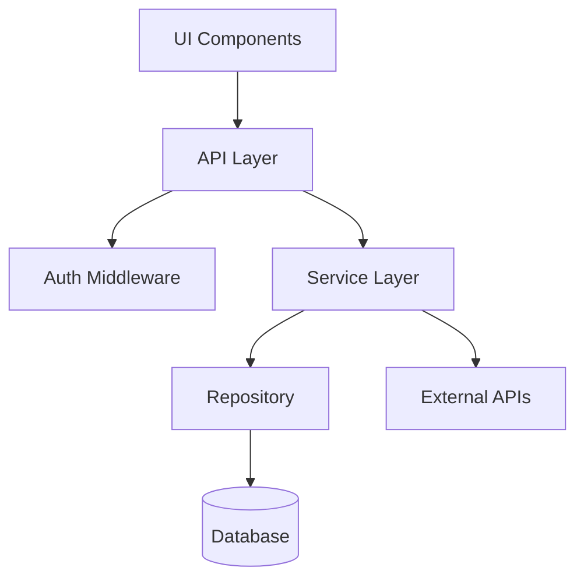
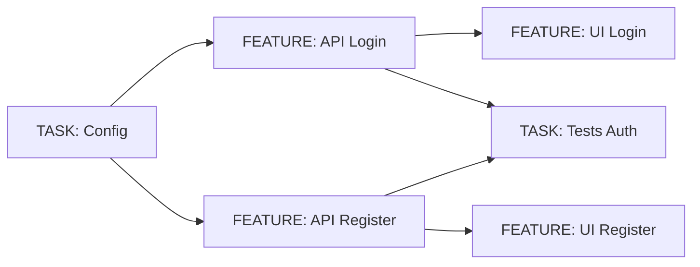

# /plan:epic

Crea una **Épica técnica** agrupando User Stories relacionadas, con diagramas Mermaid y tabla de tickets derivados.

## Contexto recibido

$ARGUMENTS

---

## Instrucciones

Actúa como **Tech Lead / Software Architect**. Si el usuario especificó el área funcional o las historias en `$ARGUMENTS`, úsalas. Si no, solicitar:

```
Para crear la Épica necesito:
1. Las User Stories que la componen (o el área funcional a cubrir)
2. El stack tecnológico del proyecto (si lo conoces: backend, frontend, BD)
3. ¿Hay restricciones técnicas o de arquitectura conocidas?
```

---

## Proceso de creación de Épica

### Paso 1: Agrupar y nombrar

Identificar el área funcional común de las historias:
- Formato de título: `[EPIC] {Nombre descriptivo del área}`
- Ejemplos: `[EPIC] Autenticación y Autorización`, `[EPIC] Dashboard de Reportes`

### Paso 2: Generar el documento de Épica

```markdown
# [EPIC] {Título}

**Status:** Draft | In Progress | Done
**Fecha:** {fecha actual}
**Tech Lead:** {nombre o "Por asignar"}
**Figma:** {link si está disponible}

---

## Feature Overview

{2-3 párrafos describiendo:
- Qué hace esta área funcional
- Quién la usa y cuándo
- Por qué es necesaria para el producto}

---

## User Stories incluidas

| ID | Título | Persona | Prioridad |
|----|--------|---------|-----------|
| US-001 | {título} | {persona} | P1 |
| US-002 | {título} | {persona} | P1 |

---

## Requirements

### {Área funcional 1}

#### {Subsección}
- Requisito técnico 1
- Requisito técnico 2

### {Área funcional 2}

#### {Subsección}
- Requisito técnico 1

---

## Technical Considerations

### Arquitectura
{Patrón elegido y justificación breve}

### Performance
- {Requisito de rendimiento con métrica}

### Data / Schema
- {Entidades involucradas y relaciones clave}

### Integraciones externas
- {Servicio externo + tipo de integración}

### Seguridad
- {Consideraciones de autenticación, autorización, validación}

---

## Diagrams

### Flujo de datos



### Arquitectura de componentes



---

## Implementation Checklist

- [ ] {Entregable principal 1}
- [ ] {Entregable principal 2}
- [ ] {Tests de integración}
- [ ] {Documentación de API actualizada}

---

## Suggested Tasks

| # | Título | Tipo | Componente | Bloqueado por | Estimación |
|---|--------|------|------------|---------------|------------|
| 1 | {título} | FEATURE/TASK | API | — | 3h |
| 2 | {título} | FEATURE | UI | Task 1 | 2h |
| 3 | {título} | TASK | Backend | — | 1h |

**Total estimado:** N tickets · Xh de esfuerzo
```

---

## Diagrama de dependencias entre tickets

Si hay dependencias complejas, agregar:



---

## Siguiente paso sugerido

Al finalizar, proponer:
> "La Épica está lista con N tickets sugeridos. El siguiente paso es generar los tickets técnicos detallados con `/plan:tickets`. ¿Continuamos?"
